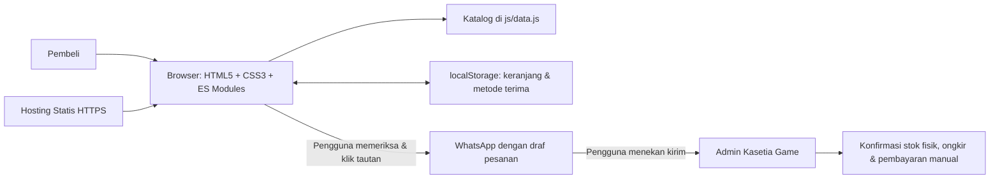
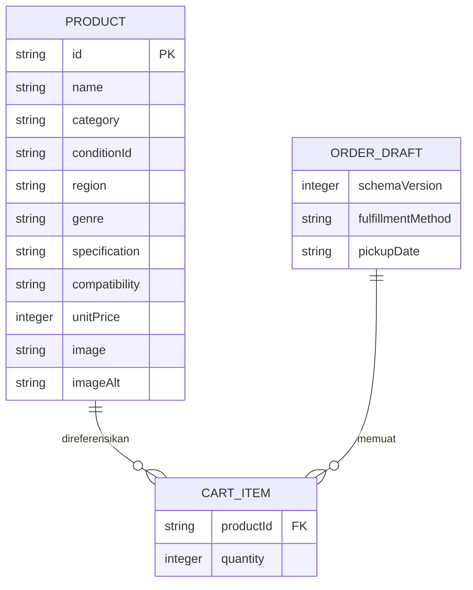

# Arsitektur Sistem — Kasetia Game

## 1. Bentuk sistem
Aplikasi web satu halaman statis berbasis modul JavaScript native (ES Modules) tanpa backend aplikasi maupun database server. Server HTTP statis hanya mengirimkan berkas HTML, CSS, JavaScript, dan ilustrasi SVG. Seluruh pencarian, penyaringan katalog, perhitungan subtotal, serta pembentukan draf pesan berjalan di browser pengguna.



## 2. Struktur berkas aplikasi
```text
/
├── index.html
├── css/
│   └── styles.css
├── js/
│   ├── config.js       # Identitas toko, jam buka, & nomor WhatsApp publik
│   ├── data.js         # Katalog 12 judul fisik (PS5 Disc, Switch 1, Switch 2)
│   ├── app.js          # Inisialisasi DOM, render aman, pencarian, event UI
│   ├── cart.js         # Kalkulasi murni keranjang, filter, & tanggal kalender
│   ├── storage.js      # Baca/tulis localStorage aman & sanitasi skema
│   └── checkout.js     # Validasi formulir & penyusunan URL WhatsApp
├── assets/images/      # Ilustrasi SVG lokal kotak, disc, & cartridge
├── tests/
│   └── store.test.mjs  # Pengujian otomatis Node.js (8 kelompok uji)
├── scripts/
│   ├── generate_svg_assets.mjs
│   └── package_site.py
├── prd.md
├── tech_stack.md
├── arsitektur.md
├── ui.ux.md
├── verification.md
└── README.md
```

## 3. Model data frontend


Contoh data tersimpan pada kunci `kasetia-game:cart:v1`:
```json
{
  "schemaVersion": 1,
  "items": [
    { "productId": "ps5-astro-bot", "quantity": 1 },
    { "productId": "nsw2-mario-kart-world", "quantity": 1 }
  ],
  "fulfillmentMethod": "pickup",
  "pickupDate": "2026-11-10"
}
```

## 4. Alur kerja utama
### Memuat halaman
1. Muat `STORE_CONFIG` dan `PRODUCTS`.
2. Baca `localStorage` di dalam blok `try/catch`.
3. Validasi `schemaVersion`, kecocokan `productId` terhadap katalog, bilangan bulat `quantity` (1–99), metode penerimaan (`pickup` atau `courier`), serta validitas `pickupDate`.
4. Apabila tanggal rencana ambil sudah terlewat dari hari lokal saat ini, tanggal dihapus otomatis dan pengguna diberi pemberitahuan ramah untuk memilih ulang.
5. Render katalog, kontrol filter, dan keranjang memakai harga resmi terbaru dari `js/data.js`.

### Mengubah keranjang & metode penerimaan
1. Validasi `productId` terhadap katalog dan gabungkan item yang sama dalam satu baris.
2. Hitung ulang jumlah unit dan estimasi harga barang secara murni.
3. Batalkan panel ringkasan pemeriksaan apabila sebelumnya sudah terbuka agar pembeli selalu memeriksa ulang perubahan terbaru.
4. Simpan state non-pribadi ke `localStorage`; jika gagal (misal mode privat ketat), tampilkan pemberitahuan tanpa menghentikan sesi belanja.

### Memeriksa dan mengajukan pesanan
1. Validasi isi keranjang, tanggal rencana ambil (untuk ambil di toko) atau kota/kecamatan tujuan (untuk kirim kurir), nama pembeli (2–80 karakter setelah trim), serta nomor WhatsApp (8–15 digit setelah normalisasi).
2. Jika ada isian salah, tampilkan pesan error di dekat field terkait (`aria-invalid="true"`) dan arahkan fokus keyboard ke field salah pertama.
3. Jika valid, tampilkan panel **Ringkasan Pemeriksaan Pesanan** di dalam halaman beserta pratinjau draf pesan, tombol **Salin Draf Pesanan**, **Ubah Pesanan**, dan **Ajukan Pesanan via WhatsApp**.
4. Susun URL `https://wa.me/<nomor>?text=<encoded>` memakai `encodeURIComponent` penuh. Keranjang tetap dipertahankan setelah pengguna membuka tautan WhatsApp karena pembukaan tautan belum berarti transaksi selesai.

## 5. Keamanan dan penanganan kegagalan
- Seluruh data dinamis dan teks masukan pengguna dirender menggunakan `document.createElement` serta `textContent` (tanpa interpolasi `innerHTML`) untuk mencegah XSS.
- Tautan eksternal WhatsApp menyertakan `rel="noopener noreferrer"`.
- Kegagalan pemuatan gambar ditangani oleh listener `error` sekali jalan menuju `./assets/images/fallback-media.svg`.
- Tersedia banner `<noscript>` agar pengguna tanpa JavaScript tetap memahami fungsi halaman dan dapat membaca panduan kompatibilitas serta informasi toko.
